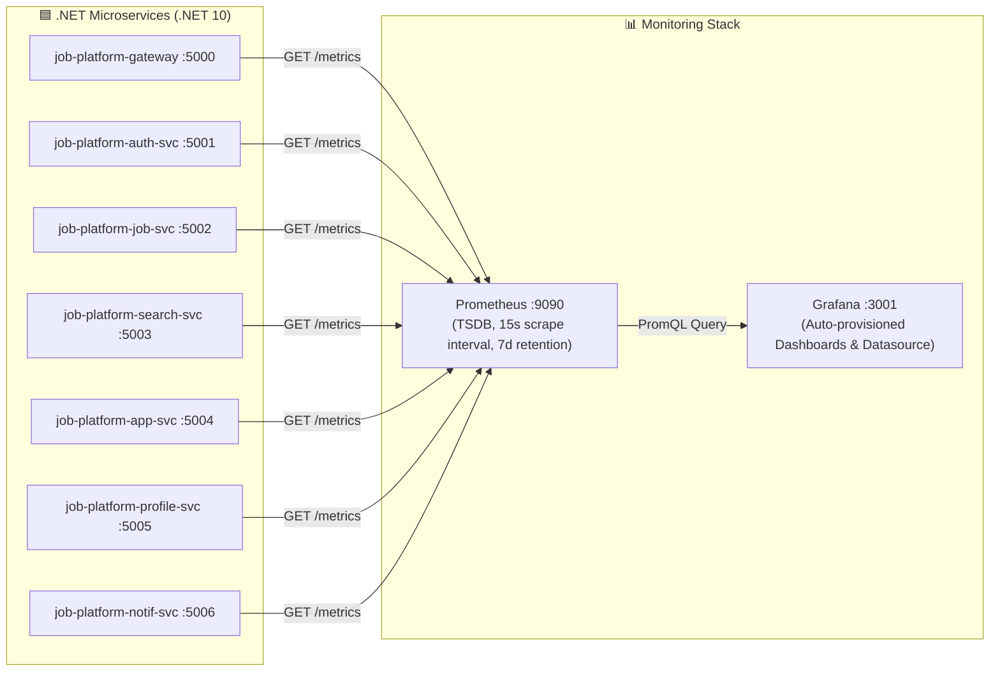

# Monitoring & Observability Architecture

This document describes the monitoring and observability architecture for the Vietnam Job Platform (`job-platform`), covering Prometheus, Grafana, OpenTelemetry instrumentation across .NET microservices, dashboard configurations, custom metric authoring, and alerting rules.

---

## 1. Architecture



### Components

1. **OpenTelemetry SDK & Instrumentation (in each .NET service):**
   - In-process telemetry collection using `OpenTelemetry.Extensions.Hosting`, `OpenTelemetry.Instrumentation.AspNetCore`, `OpenTelemetry.Instrumentation.Http`, and `OpenTelemetry.Instrumentation.Runtime`.
   - Exposes Prometheus text-format scrape output via endpoint `GET /metrics` (`OpenTelemetry.Exporter.Prometheus.AspNetCore`).
2. **Prometheus Server (`job-platform-prometheus`):**
   - Scrapes all registered endpoints every 15 seconds.
   - For services running in Docker, targets bridge DNS names (e.g. `gateway:5000`, `auth:5001`).
   - For services run directly on the host (e.g. `dotnet run`), targets `host.docker.internal:<port>`.
   - TSDB retention set to 7 days for local development.
3. **Grafana (`job-platform-grafana`):**
   - Listens on host port `3001` (to prevent conflict with frontend React dev server on port 3000).
   - Automatically loads Prometheus datasource via provisioning (`docker/grafana/provisioning/datasources/prometheus.yml`).
   - Automatically loads dashboards from `docker/grafana/dashboards/` via dashboard provisioning.

---

## 2. Key Metrics Collected

### RED Metrics (Rate, Errors, Duration)

All HTTP inbound endpoints automatically track:
- `http_server_request_duration_seconds_count`: Total requests received.
- `http_server_request_duration_seconds_sum`: Total request execution duration.
- `http_server_request_duration_seconds_bucket`: Latency distribution buckets (p50, p95, p99).
- Labels: `http_response_status_code`, `http_route`, `http_request_method`, `service`.

### .NET Runtime Metrics

Collected via `OpenTelemetry.Instrumentation.Runtime`:
- `process_runtime_dotnet_gc_heap_size_bytes`: Managed heap size per generation (Gen 0, Gen 1, Gen 2, LOH).
- `process_runtime_dotnet_gc_collections_count`: Number of GC cycles completed per generation.
- `process_runtime_dotnet_threadpool_thread_count`: Active worker and completion port threads.
- `process_runtime_dotnet_threadpool_queue_length`: Pending work items in thread pool queue.
- `process_runtime_dotnet_exceptions_count`: Thrown exceptions frequency.
- `process_runtime_dotnet_process_cpu_time_seconds`: Total CPU execution time.

---

## 3. Accessing Monitoring Tools

| Tool | Host URL | Default Credentials | Description |
|------|----------|---------------------|-------------|
| **Grafana** | [http://localhost:3001](http://localhost:3001) | User: `admin`<br/>Pass: `admin` | Dashboards, visualizations, explorations |
| **Prometheus** | [http://localhost:9090](http://localhost:9090) | None | PromQL console & expression browser |
| **Prometheus Targets** | [http://localhost:9090/targets](http://localhost:9090/targets) | None | Health status of microservice scrapers |

---

## 4. Provisioned Dashboards

### 4.1 System Overview (`job-platform-overview`)

Designed for an on-call or operations engineer to quickly diagnose high-level platform health:
- **Service Health:** Instant stat cards showing `UP` (1, green) or `DOWN` (0, red) for all microservices.
- **Request Rate (req/s):** Throughput across services over a 5m sliding window (`sum(rate(http_server_request_duration_seconds_count[5m])) by (service)`).
- **Error Rate (5xx req/s):** Server failure rate (`http_response_status_code=~"5.."`).
- **P95 Latency:** 95th percentile latency per service (`histogram_quantile(0.95, ...)`).
- **GC Heap Size:** Heap memory footprint across services.
- **Active Threads:** Worker thread count across services.

### 4.2 .NET Runtime (`job-platform-dotnet-runtime`)

Designed for in-depth CLR debugging and performance profiling:
- **Service Selector:** Multi-select variable filtering metrics by microservice.
- **GC Heap Size by Generation:** Breakdown of Gen 0, Gen 1, Gen 2, and Large Object Heap (LOH).
- **GC Collection Rate:** Frequency of Gen 0/1/2 collections per second.
- **ThreadPool Threads & Queue:** Thread allocation vs work item queues.
- **ThreadPool Completed Items / sec:** Throughput of asynchronous operations.
- **Process CPU Usage:** Percentage of CPU utilized by the CLR process.
- **Exception Rate:** Number of exceptions thrown per second.

---

## 5. Adding Custom Metrics

When adding business-specific counters or latency tracking in a service:

### Step 1: Define a `Meter`

```csharp
using System.Diagnostics.Metrics;

namespace Job.Infrastructure.Observability;

public static class JobDiagnostics
{
    public const string MeterName = "JobPlatform.JobService";
    public static readonly Meter Meter = new(MeterName, "1.0.0");

    public static readonly Counter<long> JobsCreatedCounter =
        Meter.CreateCounter<long>(
            name: "job_platform_jobs_created_total",
            unit: "jobs",
            description: "Total number of job postings created");
}
```

### Step 2: Register Meter in `Program.cs`

```csharp
builder.Services.AddOpenTelemetry()
    .WithMetrics(metrics =>
    {
        metrics
            .AddAspNetCoreInstrumentation()
            .AddHttpClientInstrumentation()
            .AddRuntimeInstrumentation()
            .AddMeter("JobPlatform.JobService") // Register your custom Meter
            .AddPrometheusExporter();
    });
```

### Step 3: Record Measurements

```csharp
JobDiagnostics.JobsCreatedCounter.Add(1, new KeyValuePair<string, object?>("category", job.Category));
```

> **Cardinality Rule:** Never use unbounded strings (user IDs, emails, request UUIDs) as label values. Use low-cardinality tags (e.g. status code, category, provider name).

---

## 6. Recommended Alerting Rules

Alert on **symptoms users feel** (high error rate, excessive latency), not internal causes:

```yaml
groups:
  - name: service_symptom_alerts
    rules:
      - alert: HighHttpErrorRate
        expr: sum(rate(http_server_request_duration_seconds_count{http_response_status_code=~"5.."}[5m])) by (service)
              / sum(rate(http_server_request_duration_seconds_count[5m])) by (service) > 0.05
        for: 2m
        labels:
          severity: page
        annotations:
          summary: "Service {{ $labels.service }} has > 5% 5xx error rate"
          description: "High HTTP 5xx error rate observed on {{ $labels.service }} for over 2 minutes."
          runbook_url: "docs/runbooks/high_http_error_rate.md"

      - alert: HighP95Latency
        expr: histogram_quantile(0.95, sum(rate(http_server_request_duration_seconds_bucket[5m])) by (le, service)) > 2.0
        for: 3m
        labels:
          severity: page
        annotations:
          summary: "Service {{ $labels.service }} P95 latency > 2s"
          description: "P95 request latency on {{ $labels.service }} has exceeded 2 seconds for 3 minutes."
          runbook_url: "docs/runbooks/high_latency.md"

      - alert: ServiceDown
        expr: up == 0
        for: 1m
        labels:
          severity: page
        annotations:
          summary: "Service {{ $labels.service }} is DOWN"
          description: "Prometheus cannot scrape {{ $labels.service }} on target {{ $labels.instance }}."
          runbook_url: "docs/runbooks/service_down.md"
```
